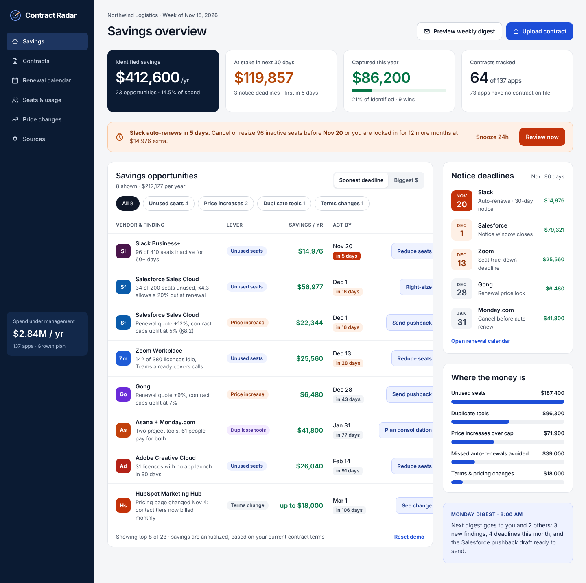
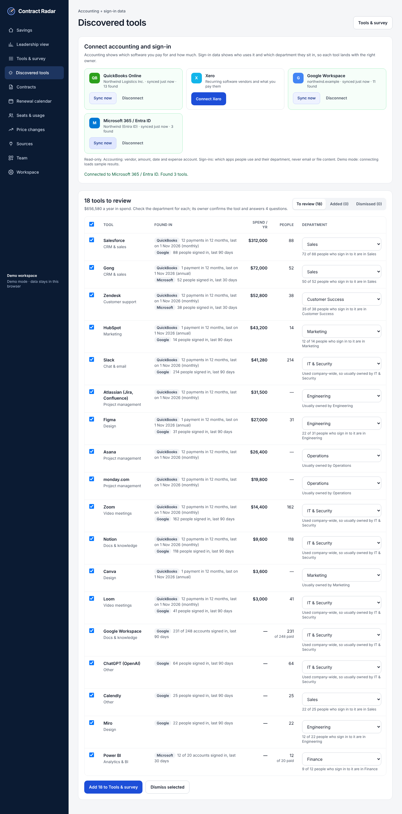
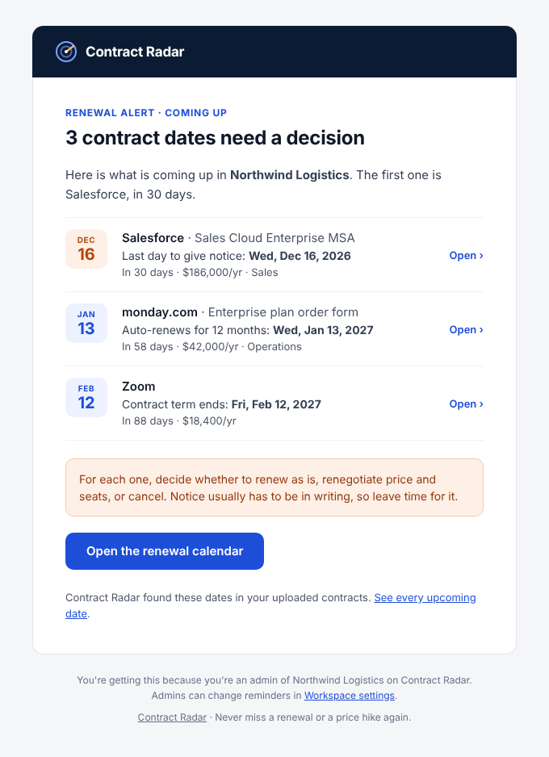

# Contract Radar AI

AI contract radar and price-increase tracker that helps mid-market companies cut SaaS spend.
The buyer is the CFO, VP Finance or procurement lead.

This is the **first clickable version**: the screens from the dashboard spec, running on seeded sample data for a
fictional company (Northwind Logistics), with stubbed connectors. One piece is real AI: upload a contract PDF and
Claude extracts the notice date, auto-renewal, uplift cap and other renewal terms, quoting the clause behind each one.



## Run it locally

You need [Node.js](https://nodejs.org/) 20 or newer.

```bash
git clone https://github.com/alexanderkalinkov/contract-radar-ai.git
cd contract-radar-ai
npm install
npm run dev
```

Open http://localhost:3000.

### Turn on real contract extraction (optional)

Without an API key the upload screen runs in **demo mode** and returns sample results, so everything stays clickable.
To have Claude read your own PDFs:

```bash
cp .env.example .env.local
# then edit .env.local and set ANTHROPIC_API_KEY=sk-ant-...
npm run dev
```

Get a key at https://platform.claude.com/. Each contract costs a few cents to read.

## Turn on login and a shared workspace (Supabase)

Without Supabase the app runs in **demo mode**: no login, and uploaded contracts are saved in your browser only.
With Supabase you get accounts, one shared workspace for your team, and every uploaded contract (and its PDF)
saved in the database.

1. **Create a project** at https://supabase.com/dashboard (any region near you; the free plan is fine).
2. **Create the tables.** Open *SQL Editor → New query*, paste the whole of
   [`supabase/migrations/20261115000000_workspaces_and_contracts.sql`](supabase/migrations/20261115000000_workspaces_and_contracts.sql)
   and click *Run*. It creates the tables, the security rules and a private `contracts` storage bucket. Then do the same with
   [`supabase/migrations/20261115120000_team_onboarding.sql`](supabase/migrations/20261115120000_team_onboarding.sql)
   (departments, tool list and survey), then
   [`supabase/migrations/20261116000000_auto_discovery.sql`](supabase/migrations/20261116000000_auto_discovery.sql)
   (connected sources and discovered tools). All are safe to run again.
3. **Copy the keys.** *Project Settings → API*: copy the Project URL and the publishable key into `.env.local`:
   ```bash
   NEXT_PUBLIC_SUPABASE_URL=https://xxxx.supabase.co
   NEXT_PUBLIC_SUPABASE_PUBLISHABLE_KEY=sb_publishable_...
   ```
4. **(Optional, for quick testing)** *Authentication → Sign In / Providers → Email*: turn off "Confirm email" so new
   accounts can sign in straight away. Leave it on for real use; the confirmation link returns to `/auth/callback`.
   If you deploy the app, add its URL under *Authentication → URL Configuration*.
5. Restart `npm run dev`. You'll be sent to `/login`. Create an account: a workspace is created for you.
6. **Set up your team:** *Team* in the sidebar (or the "Start team setup" banner) → add departments and invite their
   owners. They get an email link that signs them in to your workspace and department. Supabase's built-in email only
   sends a few messages an hour, so set up custom SMTP for real use, and add `<your-url>/auth/confirm` to the redirect
   URLs. The full flow is in [docs/onboarding-spec.md](docs/onboarding-spec.md).

7. **(Optional) Billing.** Stripe plans and a 14-day free trial: run
   [`supabase/migrations/20261116180000_billing.sql`](supabase/migrations/20261116180000_billing.sql) and follow
   [docs/billing-setup.md](docs/billing-setup.md). Without Stripe keys billing stays off.

How it fits together:

| Table | What it holds |
|---|---|
| `workspaces` | One per team. Includes the "show sample data" switch |
| `workspace_members` | Who belongs to which workspace: `owner` = admin (C-level), `member` = department owner; plus their department |
| `workspace_invites` | Pending invites by email with role and department, accepted automatically on sign-in |
| `departments` | Sales, Marketing, Engineering… per workspace |
| `tools` | Every tool the company pays for: department, cost, seats, renewal, linked contract |
| `tool_surveys` | Each department's answers to the 4 questions, kept as history |
| `connections`, `connection_secrets` | Connected QuickBooks / Xero / Google / Microsoft accounts; tokens encrypted, admins only |
| `discovery_signals`, `discovered_tools` | What each source found (spend, people, departments) and the admin's review decisions |
| `workspace_billing` | Free trial end, Stripe customer and subscription, plan and status (written only by the server) |
| `contracts` | Each uploaded contract: the full Claude extraction (quotes, pages, confidence) plus key columns (vendor, term end, notice deadline, cap, fee, seats) |
| Storage bucket `contracts` | The original PDFs, one folder per workspace |

Row-level security means people only ever see their own workspace's rows and files, and department owners can only
change their own department's tools. Only the publishable key is needed; an optional `SUPABASE_SERVICE_ROLE_KEY` (server
only) makes invites use Supabase's invite email.

## Turn on auto-discovery (QuickBooks, Xero, Google Workspace, Microsoft)

Radar can find the tools you pay for and who uses them, then file each one under the right department for its owner
to confirm. It needs one OAuth app per provider (client ID and secret) and an encryption key in `.env.local` and
Vercel. Step-by-step: [docs/auto-discovery-setup.md](docs/auto-discovery-setup.md). Without the keys, the
Discovered tools page shows "Needs setup" (or sample results in demo mode).



## Turn on renewal reminders and branded emails

Reminder emails go out 90, 60 and 30 days before each notice deadline and renewal date, to the department owner and
the workspace admins, from a daily Vercel Cron job. Team invites and all Supabase auth emails (sign-up, magic link,
password reset) share one branded design. Needs one SQL file, a Resend API key, `EMAIL_FROM`, `CRON_SECRET` and the
service role key, plus pasting the templates in `supabase/templates` into Supabase. Step-by-step:
[docs/email-setup.md](docs/email-setup.md).



## What to click

| Screen | URL | What works |
|---|---|---|
| Savings dashboard | `/` | Sort and filter opportunities, "⋯" menu to mark won, snooze or dismiss (KPIs update), urgent banner, lever bars filter the table, weekly digest preview |
| Contract renewal detail | `/contracts/salesforce` (and every other vendor) | Renewal math with "What to ask for" toggle, extracted clauses with page and confidence, seat usage, pushback email with Firm/Friendly tone, open in email, copy, mark as sent |
| Contracts | `/contracts` | Your uploaded contracts and the sample ones, sorted by notice deadline, with risk flags |
| Uploaded contract page | `/contracts/<id>` | Savings found, a Claude-drafted pushback email (goal and tone), every extracted term with the clause and page it came from, risk flags, open the original PDF, delete |
| Team setup | `/setup` | Admin wizard: company, connect accounting and sign-in, departments, invite one owner each, review discovered tools |
| Discovered tools | `/discover` | Connect QuickBooks, Xero, Google Workspace or Microsoft; review every tool found with spend, people and a suggested department; add them to Tools & survey for owners to confirm. Sample results in demo mode |
| Team | `/team` | Departments and their owners, invite by email, set each person's department and role |
| Tools & survey | `/tools`, `/tools/<id>` | Every tool by department; owners confirm theirs and answer 4 questions (purpose, criticality 1–5, replacement, seats) |
| Leadership view | `/insights` | For admins: overlapping tools across teams, high-cost low-value tools, spend by department, a keep / cut seats / consolidate / renegotiate / cancel call for every tool |
| Workspace | `/settings` | Show or hide sample data, rename the workspace |
| Upload contract | `/upload` | Real Claude extraction from a PDF. Click "Try the sample Acme Analytics MSA" if you have no contract handy |
| Onboarding | `/welcome` | First-login flow: free 3-contract audit, connect logins and spend (simulated), "Found so far" counter |
| Renewal calendar, Seats & usage, Price changes, Sources | sidebar | Read-only views over the same sample data |

Uploaded contracts appear in Contracts, the Renewal calendar, the dashboard's Notice deadlines and Price changes
(when there is no cap). Sample data can be hidden from any page or in *Workspace & team*. Clicks on the sample
opportunities are remembered in your browser; "Reset demo" clears them.

## How it's built

- [Next.js 15](https://nextjs.org/) (App Router) + TypeScript + [Tailwind CSS 4](https://tailwindcss.com/)
- [`@anthropic-ai/sdk`](https://github.com/anthropics/anthropic-sdk-typescript) with structured outputs (Zod schema) for extraction
- [Supabase](https://supabase.com/) (optional) for Postgres, auth and PDF storage, via `@supabase/ssr`
- Sample data lives in code (`src/lib/seed.ts`)

```
src/
  app/
    (app)/            screens that share the sidebar: dashboard, contracts, calendar, seats, price changes, sources, upload
    welcome/          onboarding (no sidebar)
    login/, auth/     sign in, sign up, forgot/reset password, email confirmation, sign out
    api/extract/      POST a PDF → Claude → structured renewal terms → saved to the workspace
    api/contracts/    list, open PDF, delete saved contracts
    api/invites/, api/workspace/   team invites and workspace settings
  components/         Dashboard, ContractDetail, ConnectSources, Uploader, shared UI
  lib/
    seed.ts           sample company, contracts, opportunities, sources  ← edit this to change the demo data
    engine.ts         date maths (act-by = term end − notice days), renewal math, pushback email template
    extraction.ts     the Zod schema Claude fills in, plus the demo-mode result
    saved.ts          saved-contract shape and the adapter into the views
    portfolio.ts      client hook: sample data + your team's contracts
    supabase/         Supabase clients and the session-refresh middleware
    server/           server-only helpers (current user and workspace)
    store.ts          localStorage store used in demo mode
supabase/migrations/  database schema, security rules and storage bucket
public/samples/       fictional sample contract for trying the upload
scripts/              regenerates the sample PDF
docs/screenshots/     screenshots used in this README and the PR
```

The product spec is in `docs/dashboard-spec.md` (PR #1).

## What's real and what's stubbed

| Piece | Status |
|---|---|
| Contract PDF extraction | **Real** (Claude, with an API key). Demo result without one |
| Notice deadlines, renewal math, savings per lever | Real calculations, run over sample data |
| Pushback email | Sample contracts: template. Uploaded contracts: **drafted by Claude** from the contract's own clauses (template without an API key) |
| Google Workspace, Microsoft 365, Okta, QuickBooks, Xero, cards | Simulated connect buttons |
| Accounts, shared workspace, saved contracts and PDFs | **Real** with Supabase. Browser-only in demo mode |
| Savings opportunities from uploaded contracts | Estimates from the contract alone: no renewal cap (a typical 7% rise held to 3%) and the seat-reduction allowance. Real usage and quotes come with connectors |
| Renewal reminder emails (90/60/30 days) | **Real** with Supabase, Resend and `CRON_SECRET` |
| Renewal calendar | Month grid, list and .ics export with reminders |
| Weekly digest sending | Not built yet |
| "Today" | Fixed to Nov 15, 2026 in `src/lib/engine.ts` so the sample deadlines always read the same |

## Scripts

```bash
npm run dev     # dev server on :3000
npm run build   # production build
npm run start   # serve the production build
npm run lint    # eslint
npm run email:templates  # rebuild supabase/templates/*.html after editing the auth emails
```

## Put it online (Vercel)

The app runs on [Vercel](https://vercel.com/) as-is. PDFs go straight from the browser to Supabase storage, so
Vercel's 4.5 MB request limit doesn't apply to uploads (the limit is 20 MB per PDF).

1. **Import the repo.** At https://vercel.com/new, sign in with GitHub, pick `contract-radar-ai` and click *Import*.
   Framework preset: Next.js (detected). Leave the build settings alone.
2. **Add environment variables** (same values as your `.env.local`) before the first deploy:
   `NEXT_PUBLIC_SUPABASE_URL`, `NEXT_PUBLIC_SUPABASE_PUBLISHABLE_KEY` and `ANTHROPIC_API_KEY`. Then click *Deploy*.
3. **Tell Supabase about the new address.** In Supabase, *Authentication → URL Configuration*:
   - *Site URL*: your production address, e.g. `https://contract-radar-ai.vercel.app`
   - *Redirect URLs*: add `https://contract-radar-ai.vercel.app/**`, `https://*-<your-vercel-team>.vercel.app/**`
     (so pull-request previews can confirm emails and password resets too) and keep `http://localhost:3000/**` for local work.
4. Open the address, create an account (or sign in with your existing one: it's the same Supabase project, so your
   workspace and contracts are already there), and share the link with your partner.

Vercel deploys `main` to the production address and gives every pull request its own preview link.
