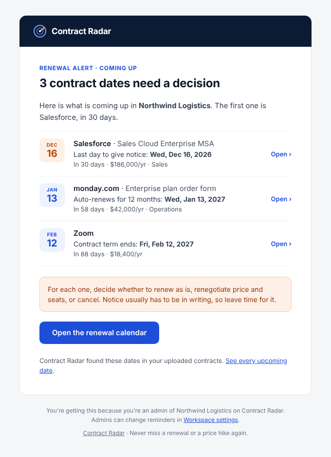

# Email setup: renewal reminders and branded emails

Every email the app sends uses one branded layout (`src/lib/email/layout.ts`): navy header with the logo, white card,
blue button, a plain-text twin, and a footer that says why the person got it. Nothing names a domain, so moving to the
real domain later is a change of environment variables, not code.

| Email | Sent by | Template |
| --- | --- | --- |
| Renewal reminder (90/60/30 days) | The app, through Resend | `renewalAlertEmail` in `src/lib/email/templates.ts` |
| Team invite (workspace, inviter, department) | The app, through Resend | `inviteEmail` in `src/lib/email/templates.ts` |
| Confirm sign up, magic link, reset password, change email, reauthentication, Supabase invite | Supabase Auth (custom SMTP → Resend) | `supabase/templates/*.html` |

Preview any of them in the browser while signed in: `/api/email-preview?t=renewal`, `renewal-digest`, `invite`,
`confirm-signup`, `magic-link`, `reset-password`, `change-email`, `reauthentication`.



## 1. Run the SQL (once)

Supabase dashboard → SQL editor → paste the whole of `supabase/migrations/20261116120000_renewal_alerts.sql` → Run.
It adds a `renewal_alerts` on/off switch to workspaces and a `renewal_alerts` log table so each reminder goes out once.

## 2. Environment variables (Vercel → Settings → Environment Variables, and `.env.local`)

| Variable | What to put |
| --- | --- |
| `RESEND_API_KEY` | Resend → API Keys → Create (Sending access). The same Resend account Supabase uses for SMTP. |
| `EMAIL_FROM` | `Outflow <alerts@your-domain.com>`, on a domain verified in Resend. |
| `EMAIL_REPLY_TO` | Optional, e.g. `support@your-domain.com`. |
| `APP_URL` | The app's address, e.g. `https://outflow.radivarius.com`. Links and the logo in emails use it. |
| `CRON_SECRET` | Any long random string (`openssl rand -hex 32`). Vercel Cron sends it to the job automatically. |
| `SUPABASE_SERVICE_ROLE_KEY` | Supabase → Project Settings → API keys → service_role / secret. Server only. |
| `RENEWAL_ALERT_DAYS` | Optional. Default `90,60,30`. Add `7` for a last-week reminder: `90,60,30,7`. |
| `EMAIL_BRAND_NAME` | Optional. Default `Outflow`. |

Redeploy after adding them. When the real domain is live: verify it in Resend, then change `EMAIL_FROM`, `APP_URL`
and the Supabase Site URL. Nothing else.

## 3. Supabase Auth templates

Open `supabase/templates/README.md`: it lists each Supabase template with its subject and file. In Supabase go to
**Authentication → Emails → Templates**, and for each one set the subject and paste the file's contents into the body.
Also check **Authentication → URL Configuration → Site URL** is the app's address, because the templates' logo and
links use `{{ .SiteURL }}`.

To change the wording or rebrand, edit `src/lib/email/auth-templates.ts` and run `npm run email:templates`.

## How reminders work

- A Vercel Cron job (`vercel.json`) calls `/api/cron/renewal-alerts` every day at 07:00 UTC.
- For every uploaded contract (sample extractions are skipped) it checks two dates: the **notice deadline** (when the
  contract auto-renews) and the **renewal date** (day after the term ends) or the **term end** (when it doesn't).
- When a date is 90, 60 or 30 days away it emails the **department owner** of the tool linked to that contract, and every
  **workspace admin**. One email per person per day, listing all their dates.
- Each send is logged in `renewal_alerts`, so nothing is sent twice. If a day is missed, or a contract is uploaded with
  45 days to go, the next run catches up with the 60-day reminder.
- Admins can turn reminders off, and anyone can email themselves a sample, in **Workspace settings**.

Test without sending anything:

```bash
curl -H "Authorization: Bearer $CRON_SECRET" "https://outflow.radivarius.com/api/cron/renewal-alerts?dry=1"
# pretend it's another day:
curl -H "Authorization: Bearer $CRON_SECRET" "https://outflow.radivarius.com/api/cron/renewal-alerts?dry=1&today=2027-01-15"
```

## Renewal calendar

`/calendar` has a month grid (dots on phones, vendor chips on wider screens) and a list view. Each date shows when its
reminder emails go out, and **Add to my calendar (.ics)** downloads every upcoming date with 90/60/30/1-day alarms for
Google Calendar, Outlook or Apple Calendar.
